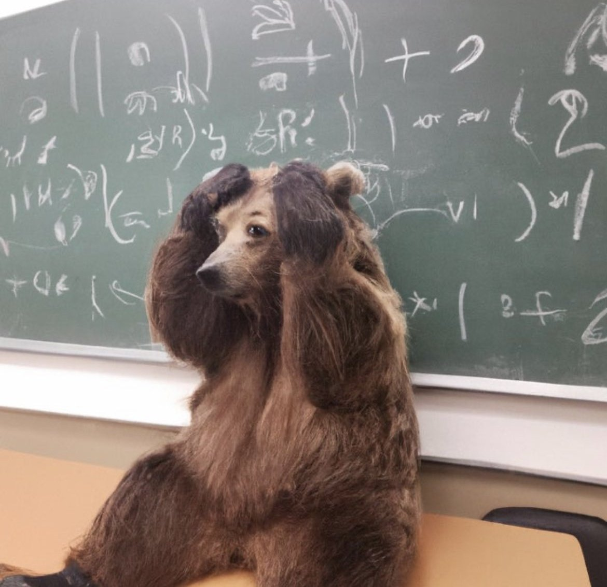

**I use mechanistic mathematical models, genomic data, and computational statistical tools to answer biological questions.** I am currently spending most of my time thinking about mutation, recombination, and other aspects of genetic architecture, which are usually thought of as inputs to the evolutionary process but are also outputs.

  

Some questions that have guided or are guiding my work:

1. **How does recombination rate variation[^1] evolve?** Recombination is a key event in meiosis and the life cycles of sexually reproducing species. Yet it varies and evolves in almost every way measured to date. An especially interesting way in which recombination varies is _along_ genomes. The landscape (i.e., distribution) of recombination varies between gametes, individuals, sexes, populations, and species[^2] and appears to be quite evolutionarily labile. A wealth of data (e.g., from single-sperm sequencing in humans and other species) makes it an exciting time to think about variation in recombination at these scales. I've been working on developing theory to understand how the recombination landscape evolves under neutrality (i.e., as modifiers arise, recombine onto various haplotypes depending on the effects they induce, and stochastically drift in frequency) and under background selection (i.e., the influx of new deleterious mutations and the coincident reduction in effective size).

2. **How does viral evolution shape disease emergence?** RNA and ssDNA viruses are so rapidly evolving that, by conventional metrics of the rate of molecular evolution, their genomes should turn over _neutrally_ in $\sim 10^3$ years[^3]. By [some estimates](https://www.pnas.org/doi/10.1073/pnas.2206945119), the rate of recombination (during co-infection of the same host) is even greater. Isn't that remarkable! I am interested in understanding how mutation and recombination shape the propensity of viruses to successfully spill over and sustain transmission (i.e., emerge) in novel hosts such as humans[^4].

3. **What are the limits to inference under evolving genetic architecture?** When we do inference from genetic data, we infer historical processes that are compatible with patterns of present-day variation. But there is no shortage of evidence that the processes which mold genetic variation (mutation, recombination, selection) can evolve and, in some contexts, quite rapidly. For example, the spread of a beneficial allele in a population remolds the distribution of fitness effects of _new_ mutations; every individual in which the allele occurs is an individual in which the back mutation can now occur. This "depletion" of the distribution of fitness effects has only recently been explored theoretically. With Kuangyi Xu, I have recently shown that depletion of the joint distribution of fitness effects in homozygotes and heterozygotes gives rise to patterns that historically have been used to evaluate various theories for the evolution of dominance. More generally, the fact that genetic architectures evolve (and the mechanisms governing the evolution of architectures themselves evolve) may seriously limit our ability to draw inferences about evolution. I think this is a very exciting frontier of population genetics!

[^1]: A great introduction to the subject is [this paper](https://www.nature.com/articles/s41576-020-0240-1) by Peñalba and Wolf.

[^2]: In fact, there is a remarkable experiment showing that the gene PRDM9, which determines where recombination occurs on the genome (i.e., the set of recombination _hotspots_) in many vertebrates, underlies [the formation of different species](https://www.nature.com/articles/nature16931) to begin with 😱.

[^3]: This estimate comes from Holmes, _The Evolution and Emergence of RNA Viruses_ (2009), which is probably one of my favorite scientific texts!

[^4]: And there happens to be a paper to this end [on bioRxiv](https://www.biorxiv.org/content/10.1101/2025.10.01.679867v2)!